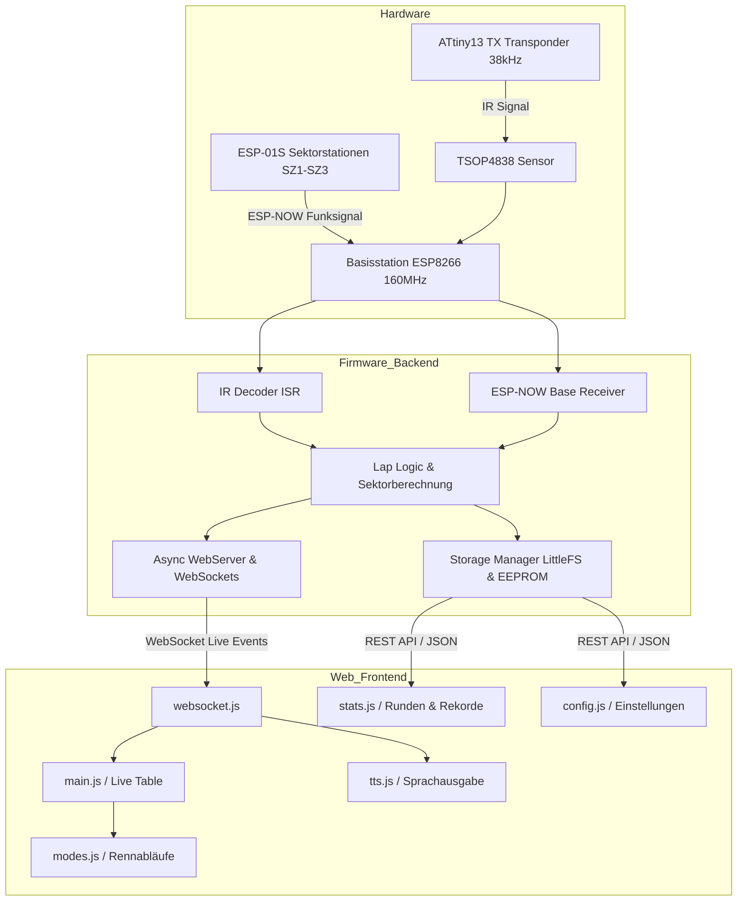

# 🏁 RC LAP TIMER PRO – SYSTEM ROADMAP & ARCHITEKTUR

> **Interne System-Roadmap & Modulübersicht für AI-Assistenten und Entwickler.**  
> *Stand Firmware: v4.4.8 | Platform: ESP8266 (160 MHz) + ATtiny13*

---

## 🧭 1. Projektübersicht & Philosophie
**RC Lap Timer Pro** ist ein autarkes, hochpräzises Infrarot-Rundenzählersystem für RC-Cars (Maßstäbe 1:10, 1:8, 1:24 etc.). Es läuft ohne Cloud oder zwingende Router-Infrastruktur auf einem ESP8266-Mikrocontroller. Die Bedienung und Live-Anzeige erfolgt komplett über ein responsives, modernes Web-Frontend (HTML5 / Vanilla JS / WebSockets).

* **Basisstation:** Empfängt IR-Transponder an Start/Ziel, betreibt Webserver/WebSockets, verwaltet Streckenrekorde, Session-Dateien und Zeitrechnung.
* **Sektorstationen (SZ1–SZ3):** Autonome Stationen an Streckenabschnitten. Erfassen Zwischenzeiten via IR und übertragen diese per **ESP-NOW Mesh/Sync** mit Zeitzonenausgleich an die Basis.
* **Transponder (TX):** Kleiner ATtiny13-Sender in jedem RC-Car, sendet individuelle 12-Bit IR-Codes auf 38 kHz.

---

## ⚙️ 2. PlatformIO Environments & Build-Konfiguration (`platformio.ini`)

| Environment | Board | CPU Takt | Dateisystem | Upload / Port | Zweck / Flags |
| :--- | :--- | :--- | :--- | :--- | :--- |
| `basisstation` | NodeMCU V2 (`nodemcuv2`) | 160 MHz | LittleFS | espota (laptimer.local) | Basisstation, AsyncWebServer, ArduinoJson 7, LWIP2 Low Memory |
| `sz1` | ESP-01S (`esp01_1m`) | 160 MHz | - | espota (SZ-1.local) | Sektorstation 1 (`-DSECTOR_STATION -DSTATION_ID=1`) |
| `sz2` | ESP-01S (`esp01_1m`) | 160 MHz | - | espota (SZ-2.local) | Sektorstation 2 (`-DSECTOR_STATION -DSTATION_ID=2`) |
| `sz3` | ESP-01S (`esp01_1m`) | 160 MHz | - | espota (SZ-3.local) | Sektorstation 3 (`-DSECTOR_STATION -DSTATION_ID=3`) |

---

## 📡 3. Hardware- & Signal-Architektur

### 3.1 Transponder (`attiny13_tx/Attiny_tx.ino`)
* **Hardware:** ATtiny13A (9.6 MHz intern), IR-LED an PB3.
* **Signal:** 38 kHz Burst (Impulsbreiten-Codierung).
* **Frame-Struktur:** 12-Bit Micro-Frame (~16 ms Dauer).
  * Leader: 2000 µs Puls + 1000 µs Pause.
  * Daten: 6 Bit Car-ID (1–15, ID 0 = Startschranke) + 6 Bit invertierte Car-ID zur Fehlerprüfung.
  * Bit 0 = 350 µs Puls / 350 µs Pause (~700 µs).
  * Bit 1 = 350 µs Puls / 1050 µs Pause (~1400 µs).
* **Entzerrung:** LFSR Pseudo-Zufallspause von 15 bis 30 ms zwischen Sendungen (verhindert Signalüberlagerung bei Pulkfahrten).

### 3.2 IR-Decoder (`esp8266_rx/src/ir_decoder.cpp`)
* **Hardware:** TSOP4838 an D2 (GPIO4 bei Basis) bzw. GPIO3/RX (ESP-01S bei SZ).
* **Empfang:** Interrupt auf fallende Flanke (`handleIRInterrupt()`).
* **Sicherheit:** Striktes Timing-Fenster für Header (1800–4200 µs) und Bits (400–1800 µs, Schwelle 950 µs). Bei jeder kleinsten Abweichung erfolgt ein sofortiger Hard-Reset des Schieberegisters.

### 3.3 ESP-NOW Funknetzwerk (`esp_now_base.cpp` & `src_sz/main.cpp`)
* **Sync-Master:** Basis sendet periodische Beacons (`BeaconSyncPacket`, Stratum 0).
* **Kanal-Verfolgung:** Sektorstationen hoppen durch die WLAN-Kanäle bis zum Beacon-Lock.
* **Multi-Hop / Stratum:** Stationen synchronisieren lokale Mikrosekunden mit ~1 ms Hop-Kompensation und leiten Pakete weiter (Relay Queue & Cache).
* **Heartbeat & Telemetrie:** Alive-Pakete melden Status und Batteriespannung (Teiler an A0).
* **Remote OTA-Trigger:** Basis kann SZs über ESP-NOW anweisen, in den Wartungsmodus zu wechseln und sich mit dem Heim-WLAN oder AP für Firmware-Updates zu verbinden.

---

## 💻 4. Backend-Architektur Basisstation (`esp8266_rx/src/`)

### 4.1 Zeit- & Rennlogik (`lap_logic.cpp`)
* **Rennmodi:**
  * `MODE_PRACTICE` (0): Freies Training, endlose Zeiterfassung, automatische Erkennung.
  * `MODE_QUALIFYING` (1): Zeitbasiertes Qualifying mit automatischer Restzeitansage.
  * `MODE_RACE_LAPS` (2): Rennen auf Rundenanzahl (Startampel / Countdown, Zieldurchfahrt).
  * `MODE_RACE_TIME` (3): Rennen auf Zeit (z. B. 5-Minuten-Lauf, letzte Runde zu Ende fahren).
  * `MODE_DRAGRACE` (4): Sprint-Messung (Start an Basis, Sektor-Messung bis Zielschranke).
* **Sektoren (SZ1–SZ4):** S1 bis S3 von Funk-Stationen, S4 = Zieldurchfahrt Basis. Berechnung von Einzel- und Splitzeiten, Personal Best (PB, Grün) und absoluter Bestzeit (Purple).
* **Filterung & Entprellung:**
  * 2-Frame-Filter (erfordert zwei identische Frames innerhalb von 85 ms).
  * Einstellbare Deadtime (`minLapTimeMs`, Standard 2000 ms).
  * Dynamische Boxen-/Pause-/Outlap-Erkennung bei langen Standzeiten.

### 4.2 Speicherverwaltung (`storage.cpp`)
* **Dateisystem LittleFS:**
  * `/tracks.json`: Streckenkatalog mit All-Time Top 5 und Tagesbestzeiten Top 5.
  * `/sessions.json`: Index aller gefahrenen Sessions.
  * `/<track>/<mode>/<YY-MM-DD_HH-MM-SS>.json`: Detaillierte Rundenprotokolle inklusive aller 4 Sektoren und Zeitstempel.
  * `/wifi.json` & `/names.json`: WLAN-Zugänge, Fahrer- und Fahrzeugnamen (bis zu 15 Fahrzeuge).
* **Pufferung & Schutz:**
  * `PendingLap lapQueue[30]`: Rundenzeiten werden im RAM gepuffert und asynchron weggeschrieben, um den Loop nicht zu blockieren.
  * **95%-Flash-Schutz (`storageFullLocked`):** Verhindert das Einfrieren des ESP8266 bei vollem Speicher.

### 4.3 Arcade-Sound & Signal-Akustik (`buzzer.cpp` / `buzzer.h` / `Sound/`)
* **Hardware:** 32Ω Mylar- oder PC-Lautsprecher an **D1 (GPIO5)**, getrieben über **BC337-Transistor** (1kΩ Basiswiderstand) an 5V/VIN.
* **Architektur:** 100% non-blocking State-Machine im `loop()`, **0 Byte Heap-Allokation** (alle Tonfolgen in `PROGMEM` unter `esp8266_rx/Sound/`), dynamische Staccato-Artikulation für klassische MIDI- und `wav2c`-extrahierte Notenfolgen.
* **Sound-Events & Soundtracks:**
  * **Startampel:** Original Grand Prix Circuit (1988) Sequenz (2x Rot 260 Hz à 300 ms, 650 ms Pause ➔ Grün 1050 Hz à 450 ms), synchronisiert mit Renn-Countdown in `modes.js`.
  * **Zieldurchfahrt:** Kurzer, trockener Bestätigungs-Impuls (1760 Hz, 35 ms) direkt bei Zieldurchfahrt in `lap_logic.cpp`.
  * **Streckenrekord:** Aufsteigende 4-Ton Arcade-Fanfare bei neuem Streckenrekord / absoluter Bestzeit.
  * **Accolade Arcade Jukebox (8 Original MS-DOS Chiptunes):**
    * *Grand Prix Circuit (1988):* Title Theme (180 Noten, 32s) & Menu Theme (448 Noten, 54s).
    * *Test Drive 1 (1987):* Intro / Title Theme & Menu Beat (authentischer Synth-Groove).
    * *Test Drive 3: The Passion (1990):* The Passion Theme, Radio 1 (Synth-Rock), Radio 2 (Synth-Bass), Radio 3 (Melodic Groove).
* **Steuerung & UI-Integration:**
  * **Rennleiter Jukebox-Modal (`admin.html`):** Button `📼 Arcade Audio` öffnet dedizierten Player mit Soundtrack-Dropdown, Loop-Schalter, Play/Stop und Sound FX Tests.
  * **Countdown-Stummschaltung:** Einstellbar im Fahrer-Setup (`index.html`) und direkt im Arcade-Modal des Rennleiters (`admin.html`) für 100% synchronen Startampel-Buzzer ohne Sprach-Latenz.
  * **Web-API:** `/api/buzzer` (`cmd=play&track=<id>&loop=1|0`, `cmd=start|lap|record|title|menu|stop`, `enable=1|0`).
* **Ruhestrom-Schutz:** Pin wird im Standby fest auf `LOW` gehalten, sodass der Transistor komplett sperrt und kein Strom fließt.

### 4.4 Webserver & Netzwerk (`web_server.cpp` / `web_handlers.cpp`)
* **WLAN-Kaskade:** Heim-WLAN ➔ Mobiler Hotspot ➔ Eigener SoftAP (`RC-LapTimer-XXXX`, hartes Limit auf 4 Clients).
* **Gelernte IP:** Merkt sich die im Heimnetz vergebene IP und nutzt diese auch im SoftAP, damit Browser-Lesezeichen immer gültig bleiben.
* **Geister-WLAN (`setupGhostWLAN()`):** Nach dem Booten im Heimnetz wird kurzzeitig ein eigenes Hilfs-WLAN mit der IP im Namen aufgespannt (`LT_<SSID>-<IP>`), damit der Nutzer die IP sofort sieht. Schaltet nach dem ersten Webaufruf automatisch ab.
* **Dynamischer Heap-Schutz:** Weist Verbindungen und `/api/laps`-Anfragen mit HTTP 503 (`BUSY_HTML_PROGMEM`) oder WebSocket-Code 1013 ab, wenn der freie RAM unter 16 kB sinkt, die Fragmentierung 55 % übersteigt oder der freie Block < 3 kB ist.
* **4-Säulen Client-Lifecycle:** Verhindert TCP-PCB-Erschöpfung auf dem ESP8266 im AP-Modus:
  1. `tabId`-Zuordnung via `sessionStorage` (Reloads im selben Browser-Tab ersetzen alte Sockets gezielt).
  2. TCP-Sendestau-Erkennung (`queueLen() > 0` für $\ge 8\,\text{s}$) für gesperrte Handys im Standby.
  3. `ws.cleanupClients(3)` garantiert stets min. 2 freie lwIP-PCBs für HTTP-Assets.
  4. Sauberes Teardown via `pagehide` / `beforeunload` ohne Reconnect-Stürme.

---

## 🖥️ 5. Frontend-Architektur (`esp8266_rx/data/`)

* **`index.html` (Fahrer-Dashboard):**
  * Bereinigtes Display für Teilnehmer und Zuschauer.
  * Integrierter **OLED-Dimmer-Modus**: Großschrift-Ansicht für Handys an der Strecke mit minimalem Akkuverbrauch.
* **`admin.html` (Rennleiter):**
  * Vollzugriff auf Session-Steuerung, Streckenwechsel, Fahrerumbenennung, Sensor-Live-Debug und Hardware-Konfiguration.
* **`main.js`:**
  * Zentraler Controller, WebSocket-Event-Verarbeitung (`lap`, `sector`, `outlap`, `drag_start`, `drag_finish`).
  * Live-Leaderboard-Rendering mit Delta-Zeiten zur Bestzeit.
* **`modes.js`:**
  * Start-Sequenzen (3-2-1-Los Sprachcountdown), Rennabbruch, Runden- und Zeit-Sessions.
* **`stats.js`:**
  * Multi-Tab-Statistiken (Fahrerprofile, Trainings, Quali, Rennen, Dragrace).
  * Strecken-Filterung, Session-Details mit Einzelrunden.
  * **Backup & Restore:** Vollständiger JSON-Export und Wiederherstellung aller Strecken- und Session-Daten.
* **`config.js`:**
  * Dialoge für WLAN-Umschaltung, Transponder-Deadtime, 2-Frame-Filter, Sektor-Audio, Cache-Steuerung und SZ-OTA.
* **`tts.js`:**
  * Web Speech API Sprachausgabe auf Deutsch (`de-DE`).
  * Sprach-Warteschlange mit Watchdog, gezielte Fahrer-Filterung ("Nur mein Auto ansagen"), iOS-Audio-Unlock.
* **`update.html`:**
  * LittleFS-Dateimanager (Ordner-Ansicht, ZIP-Download einzelner Ordner oder des gesamten Speichers) und Firmware-OTA-Upload.
* **`debug.html`:**
  * Live-Monitoring von ESP-Loop-Zeiten, Heap, ESP-NOW Funkpaketen und Signalstärken.
  * Integrierte **Frontend- & Asset-Live-Diagnose** (HTTP-Status, GZIP-Prüfung, Syntax-Check, WebSocket-Handshake).

---

## 🗺️ 6. Funktions- & Modul-Matrix

---

## 📋 7. Unverzichtbare Entwicklungsregeln für Antigravity

1. **Zuerst reden, dann coden:** Jede Codeänderung oder Feature-Erweiterung wird zuerst diskutiert und konzipiert. Erst nach Bestätigung des Users wird editiert.
2. **Dual-Tree-Synchronisation:** Jeder Code- oder Datei-Schreibvorgang muss **zeitgleich** in beiden Pfaden gepflegt werden:
   * Worktree: `C:\Users\Domsen\.gemini\antigravity\worktrees\RC-LAP-TIMER-PRO\analyze_project_structure_roadmap\`
   * Haupt-Repo: `C:\#Coding\Github\RC-LAP-TIMER-PRO\`
3. **Cache-Busting-Pflicht:** Sobald `data/*.js` oder `data/*.css` geändert werden, **muss** die Versionsnummer in `admin.html`, `index.html` und `config.h` (`FIRMWARE_VERSION`) synchron erhöht werden (`?v=X.X.X`).
4. **RAM-Schonung auf dem ESP8266:** Nie blockierende Loops oder große Strings auf dem Heap erzeugen. JSON-Dokumente strikt mit `ArduinoJson 7` reservieren oder direkt streamen.
5. **Code-Integrität:** Bestehende Sicherheitsmechanismen (Heap-Guard, 95%-Flash-Schutz, Sektor-Entprellung, ISR-Zeitschranken) niemals aus Versehen entfernen oder abschwächen.
